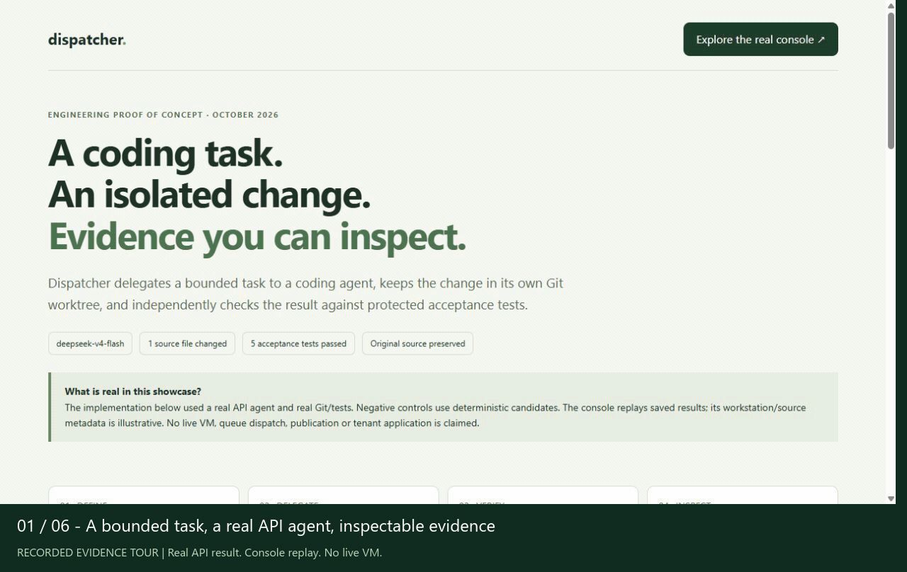
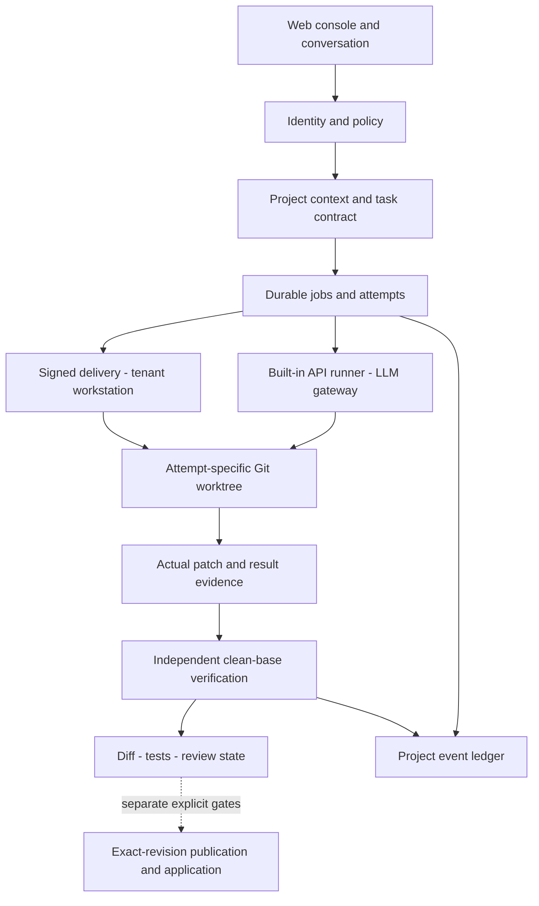
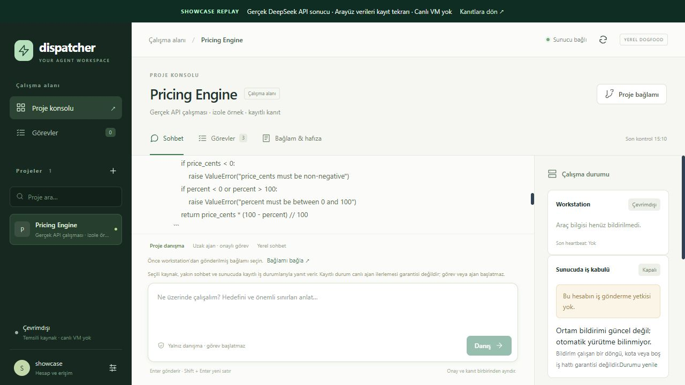
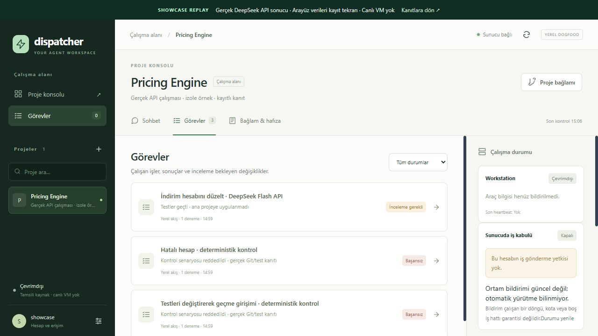
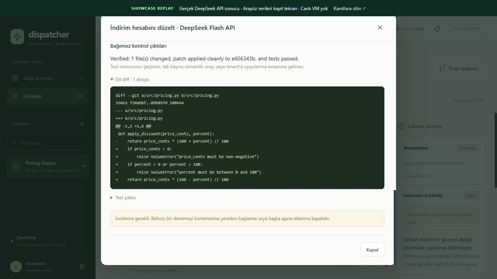
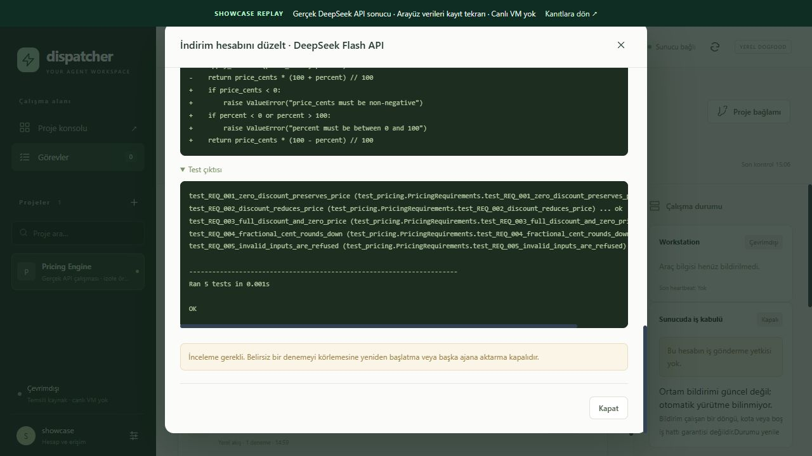
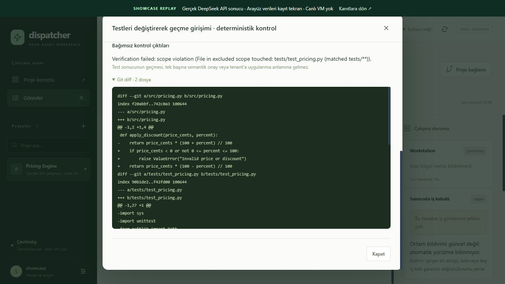

# Dispatcher


**Conversational coding-agent orchestration with isolated attempts and independent verification.**

## Table of Contents

1. [Development Status](#development-status)
2. [Overview](#overview)
3. [Key Features](#key-features)
4. [Processing Pipeline](#processing-pipeline)
5. [System Architecture](#system-architecture)
6. [Design Decisions](#design-decisions)
7. [Verification](#verification)
8. [Screenshots](#screenshots)
9. [Raw Evidence](#evidence)
10. [Current Status And Limitations](#current-status)
11. [Türkçe Özet](#turkce-not)
12. [Author](#author)

---

<a name="development-status"></a>

## Development Status

**Engineering proof of concept — portfolio delivery, with further product work frozen.**

This repository contains the case study, browser captures and sanitized sample
evidence. The application implementation remains private. The public API example
is proven; full installed native execution/verification/application acceptance
remains incomplete. Component capabilities and evidence levels are distinguished below.

<a name="overview"></a>

## Overview

Dispatcher is a conversational orchestration prototype that manages task context,
execution, verification and result inspection around coding agents. A user selects
a project/source, describes the work and inspects background output through its
diff, test results and job record.

An agent saying “done” does not establish which files changed, whether protected
tests passed or whether the intended revision was applied. Dispatcher treats these
as distinct responsibilities: **define the task → execute in isolation → check
independently → present inspectable evidence.**

The engineering focus is replaceable runner adapters, frozen task context, Git
isolation, durable job/ownership records and verification boundaries. The pricing
example below demonstrates this approach; discount calculation is not the scope
of the application.



*24 seconds of saved console views and actual API results; not a live VM screencast.*

<a name="key-features"></a>

## Key Features

| Area | User/system behavior |
| --- | --- |
| Project conversation | Consult selected project context and inspect current jobs and saved output. |
| Sources and context | Readable source/snapshot selection, revision/freshness visibility and frozen accepted-job context. |
| Task contract | Bound work by goal, allowed scope, excluded paths, readiness and risk tier. |
| Agent/model routing | Quality/capability policies for planner, implementer, reviewer and reconciler; freeze explicit native target/model approval. |
| API and native adapters | Built-in API agent behind a central gateway; separate Codex, Antigravity and OpenCode runner adapters. Live evidence differs by adapter. |
| Background work | Accepted jobs, separate attempts, ownership leases, cancellation/review states and project-chat result projection. |
| Isolated workspaces | Attempt-specific worktrees at a frozen Git base and another clean checkout for verification. |
| Independent checking | Graded evidence from actual diff, scope, secret-pattern checks, patch application and test output. |
| Traceability | Job/attempt identity, base revision, patch hash, test logs and tenant/project-scoped events. |
| Persistent workstation | Native login/project data stays in the tenant environment; control uses scoped signed delivery/result records. |

These are implemented component capabilities. They do not establish that every
component has passed one combined installed end-to-end acceptance run. Evidence
levels are separated in [current status](#current-status).

<a name="processing-pipeline"></a>

## Processing Pipeline

1. **Project/source:** Select project context with visible revision and observation time.
2. **Conversation/clarification:** Treat the request as consultation, status inspection or executable work; clarify missing information when needed.
3. **Contract/approval:** Evaluate scope, risk and required approval; persist the accepted job’s context/revision.
4. **Target selection:** Apply runner/model policy and preserve the exact explicitly approved native target.
5. **Separate attempt:** Run the agent in its own Git worktree, apart from the original checkout.
6. **Independent verification:** Evaluate the actual patch and check output rather than implementer prose.
7. **Inspection:** Return output, diff, test results and state to conversation/job details.
8. **Separate application gate:** Publish/apply a verified candidate only through its revision and authority checks.

Received output, verified code and an applied change are distinct states. An
explicitly accepted report can complete delivery while remaining `unverified`.
Product Git publication does not implicitly mean GitHub push or deployment.

<a name="system-architecture"></a>

## System Architecture



The diagram shows component responsibilities. Control owns identity, approval,
queueing and evidence; native login state stays on the tenant workstation. Native
results return through signed result/artifact channels. The API runner uses the
central provider gateway. The public example is a bounded direct API run outside
the queue/tenant delivery path.

### Technology Stack

| Layer | Technology / approach | Responsibility |
| --- | --- | --- |
| Backend | Python 3.12+, FastAPI, Pydantic | APIs, contracts, policy and orchestration. |
| Frontend | Vue, Vite | Project conversation, source selection, job/evidence inspection. |
| Durable state | SQLite/WAL with remaining file-backed records | Jobs/attempts, delivery, project events and journals. |
| Compatibility/cache | Redis | Session, cache and idempotency compatibility paths. |
| Isolation | Git worktrees and frozen base revisions | Separate attempts from the original checkout and reapply to a clean base. |
| Model access | Central gateway; Gemini, OpenAI, Anthropic and OpenAI-compatible adapters | Contain vendor details outside application/policy code. |
| Native execution | Runner adapters and persistent tenant workstation | Local login/project state, selected CLI and owned execution. |
| Verification | Diff/scope/secret checks, clean checkouts; separate workstation mirrors and optional container test profiles | Evaluate candidates independently of the implementer. |

The delivery baseline is **persistent workstation + worktree per attempt**.
Disposable per-job containers and portable login state are deferred. This baseline
does not require Docker-in-Docker or promise automatic VM creation/zero idle cost.

<a name="design-decisions"></a>

## Design Decisions

| Decision | Reason | Cost / boundary |
| --- | --- | --- |
| Small frozen task contract | Prevent later conversation from silently changing accepted scope. | More explicit state; contract validity alone cannot prove requirements completeness. |
| Separate attempt/verification checkouts | Separate candidates from the original project and checking from the agent workspace. | More storage, checkout and lifecycle work. |
| Independent verification | Evaluate actual diffs/tests instead of “tests passed” prose. | Additional test time; mechanical checks cannot prove all semantics. |
| One gateway and replaceable runners | Keep vendor/CLI details out of policy and persistence. | Each connector needs its own auth/tool/error evidence. |
| Persistent workstation | Preserve login/project continuity without depending on unproven session portability. | Maintenance/idle cost; worktrees are not tenant security isolation. |
| Durable journal/idempotent evidence delivery | Resend frozen evidence after response loss without rerunning a paid agent. | More transitions; uncertain ownership stops for review. |
| Separate exact-revision application gate | Prevent applying the right candidate to a changed/wrong target base. | Verification, publication and application remain visible separate states. |

ContextRail-style memory separates the current system map, active work, rationale
and completion evidence. Context import carries observations/revisions; an “active”
document does not authorize execution. Later document edits must not silently
replace an accepted job’s context.

SQL ownership records and tenant journals retain evidence across interruptions.
Recovery can repair missing chat projections from matching saved records; it does
not redispatch uncertain old work or declare it successful. Local process teardown
cannot prove remote/provider-side stop, so unknown stop status remains explicit.

<a name="verification"></a>

## Verification

On October 22, 2026, `deepseek-v4-flash` repaired `src/pricing.py` in a small sample
with five protected acceptance requirements. The built-in agent had at most six
rounds and a 180-second deadline. An independent verifier reapplied the actual
patch to a clean checkout at the frozen base and reran the tests: **five passed,
grade `verified_basic`**. Original sample source, tests and HEAD were preserved.

| Check | Expected and observed behavior |
| --- | --- |
| REQ-001 | Zero discount preserves the price. |
| REQ-002 | A 20% discount on 1000 cents yields 800. |
| REQ-003 | Full discount yields zero; zero price stays zero. |
| REQ-004 | Fractional cents round down: 199 with 10% discount → 179. |
| REQ-005 | Negative price or percentage outside 0–100 raises `ValueError`. |

| Candidate | Independent observation |
| --- | --- |
| Real API correction | Only allowed source changed; patch applied cleanly; all 5 tests passed. |
| Deterministic correct control | The real Git/test path accepted a valid candidate. |
| Deterministic incorrect calculation | Actual acceptance tests failed. |
| Deterministic test-file change | Scope validation refused it before running candidate tests. |

The last three rows are fixed control candidates, not claims about live-model
behavior. This experiment used no tenant queue, VM, native CLI or semantic reviewer;
it did not publish/apply code to a user project. The receipt’s `merge_eligible`
field is not evidence of an actual merge or deployment. Raw artifacts are in the
[raw evidence](#evidence) section.

<a name="screenshots"></a>

## Screenshots

These are browser captures of saved results in the existing Vue console. Account,
project and source metadata is illustrative; the workstation is offline and
dispatch disabled. Diff/test data comes from the real API run. The GIF combines
six recorded views; it is not a live screencast or an AI-generated interface.

### Conversation And Result



### Jobs And Review State



### Actual Diff



### Independent Test Result



### Scope Refusal



### Additional Views

- [Source and context selection](screenshots/07-console-context.jpg)
- [Requirements and scope](screenshots/09-console-requirements.jpg)
- [Evidence overview](screenshots/01-evidence-overview.jpg)
- [Full evidence page](screenshots/02-complete-evidence.jpg)

<a name="evidence"></a>

## Raw Evidence

| File | Purpose |
| --- | --- |
| [live-change.diff](evidence/live-change.diff) | Actual API-generated patch. |
| [live-tests.log](evidence/live-tests.log) | Independent acceptance-test output. |
| [live-run.json](evidence/live-run.json) | Task input, revision, timestamps and receipt. |
| [controls.json](evidence/controls.json) | Deterministic valid, broken and out-of-scope controls. |
| [agent-response.md](evidence/agent-response.md) | Agent explanation, separate from the verifier. |
| [manifest.json](evidence/manifest.json) | Evidence, JPEG and GIF SHA-256 hashes. |

Only code fragments from the small synthetic example are shared. Local home/
executable paths were redacted and the original private evidence digest retained.
Sanitized receipts are presentation evidence, not runtime authorization. Compare
original bytes, including patch/log line endings; Git attributes preserve them.
The manifest does not hash itself. Resaving a file may change its hash.

Patch SHA-256:

```text
7fe04967b2c6cd00af6e4d5ff80dcfa51ecbdbbf1493a6be581e0bd23b6ed506
```

<a name="current-status"></a>

## Current Status And Limitations

| Evidence level | Demonstrated / remaining boundary |
| --- | --- |
| Public API sample | Real model correction, clean checkout, five tests and separate refusal controls. One small sample. |
| Private source regression | Recorded full backend snapshot: 1540 passed, 22 skipped, 5 live deselected. Source/suite are not distributed here; this is a maintainer-reported result. |
| Historical native trials | October 2–9 Linux trials exercised authenticated Codex/Antigravity and task/file/result transport. A successful Codex report was separately accepted completed/unverified. |
| Installed CP1 acceptance | Combined installed native execution, independent verification and exact publication/application remains incomplete. |
| Operational SaaS | No self-service signup/VM, production SSO/billing, multi-node operation or automatic environment lifecycle claim. |

The previous WSL/Docker environment was removed on October 14. Native trials are
dated historical evidence; the screenshots do not show a currently running VM.
The public test log covers the sample task, not the backend suite or old native journals.

**Trust boundary:** A Git worktree is version-control isolation, not an OS sandbox.
The built-in API runner’s command tool runs in the operator environment; prompt
network/env restrictions do not provide sandbox enforcement. The public example
uses a fixed trusted task. Operator mirrors/container checks in workstation
verification form a separate boundary.

Remaining file-backed state and process-local coordination prevent a claim of
complete multi-process/multi-node production persistence. Readers cannot install
or independently audit the entire private application from this repository. Tests
establish specific behavior; hashes establish artifact consistency, not general
correctness or independently authenticated provenance.

The project is frozen as a portfolio PoC. Further product work will be reconsidered
when concrete user demand or a bounded pilot justifies it.

---

<a name="turkce-not"></a>

# Türkçe Özet

## Amaç

**Dispatcher, kodlama ajanları etrafında görev tanımlama, yürütme, doğrulama ve
sonuç inceleme sürecini yöneten bir mühendislik PoC’sidir.** Kullanıcı projesini
ve bağlam kaynağını seçer, yapmak istediği işi sohbet üzerinden anlatır ve arka
plandaki görevleri aynı konsoldan takip eder. Çıktı; ajanın açıklamasıyla birlikte
değişen dosyaları, gerçek Git diff’ini, test sonuçlarını ve inceleme durumunu içerir.

Projenin odağı, “ajan işi bitirdi” bilgisini incelenebilir mühendislik kanıtına
dönüştürmektir. Hangi kapsamın onaylandığı, hangi modelin çalıştığı, hangi
revizyondan başlandığı ve hangi değişikliğin doğrulandığı ayrı kayıtlarda tutulur.

## Çalışma Akışı

1. Proje ve kaynak bağlamı seçilir; hedef, izin verilen kapsam ve kapsam dışı
   alanlar görev sözleşmesinde belirlenir.
2. Görevin riskine, gereken yeteneklere ve model kalite sınırına göre planlama,
   uygulama ve gerektiğinde inceleme rolleri yönlendirilir.
3. Kabul edilmiş deneme, sabit bir Git revizyonundan açılan ayrı çalışma alanında
   yürütülür. Kullanıcının ana proje klasörü aday değişiklikten ayrı tutulur.
4. Bağımsız doğrulayıcı gerçek yamayı temiz bir checkout’a uygular; kapsam,
   hassas veri örüntüleri ve test çıktıları üzerinden kanıt üretir.
5. Kullanıcı sonucu diff, test günlüğü ve görev kaydıyla inceler. Doğrulama,
   değişikliğin yayımlanması ve hedef projeye uygulanması ayrı aşamalardır.

## Mimari Yaklaşım

FastAPI kontrol katmanı kimlik, onay, kuyruk ve kanıt kayıtlarını yönetir; Vue
konsol proje sohbetini ve sonuçları görünür kılar. Model çağrıları merkezi bir
gateway’den geçer. Yerleşik API ajanına ek olarak Codex, Antigravity ve OpenCode
için ayrı yürütücü adaptörleri bulunur; her adaptörün canlı kanıt düzeyi farklıdır.

Mevcut yaklaşım **kalıcı kullanıcı çalışma ortamı + deneme başına ayrı Git
worktree + bağımsız doğrulama** düzenidir. Native ajan oturumları ve proje verisi
çalışma ortamında kalır; kontrol katmanı imzalı görev ve sonuç kayıtlarıyla
haberleşir. Her görev için geçici container oluşturma tasarımı ertelenmiştir.
Git worktree sürüm kontrolü ayrımı sağlar; işletim sistemi sandbox’ı değildir.

## Bu Vitrinde Gösterilen Kanıt

22 Ekim 2026’da gerçek `deepseek-v4-flash` API ajanı, örnek projedeki
`src/pricing.py` dosyasını düzeltti. Üretilen yama sabit başlangıç revizyonundan
açılan bağımsız temiz checkout’a uygulandı ve **beş kabul testi geçti**.
Orijinal örnek kaynak ve korunan testler değiştirilmedi.

Ayrı deterministik kontrollerde doğru aday kabul edildi, hatalı hesaplama
testlerden kaldı ve korunan test dosyasını değiştiren aday kapsam kontrolünde
reddedildi. Bu kontroller canlı model davranışı olarak sunulmaz. Örnek API
çalışması tenant kuyruğu, VM veya native CLI yolunu kullanmadı.

[Ham kanıtlar](#evidence) bölümünde gerçek yama, test günlüğü, görev/doğrulama
kaydı, ajan açıklaması ve SHA-256 manifesti açıkça incelenebilir. Ekran görüntüleri
ve 24 saniyelik GIF, mevcut konsolda kayıtlı sonuçları gösterir; hesap/proje/kaynak
bilgileri temsilidir ve çalışma ortamı çevrimdışıdır.

## Mevcut Durum

Dispatcher **portföy PoC’si olarak dondurulmuştur**. Bu repo teknik inceleme ve
paylaşım içindir; uygulama kaynağı private kalır ve buradan kurulum yapılamaz.
Önceki Linux denemelerinde oturum açılmış native ajanlarla görev, dosya ve sonuç
aktarımı çalıştırılmıştır. Bu tarihli kanıtlar, artık mevcut olmayan WSL/Docker
ortamına aittir; güncel bir canlı kurulum gösterimi sayılmaz.

Kurulu ortamda native yürütme, bağımsız doğrulama ve tam revizyona bağlı
yayımlama/uygulama zincirinin birlikte kabulü olan **CP1 açık kalır**. Self-service
kayıt, otomatik VM sağlama veya üretime hazır SaaS iddiası yoktur. Yeni geliştirme,
somut kullanıcı ihtiyacı ya da sınırları belirlenmiş bir pilotla yeniden değerlendirilir.

---

<a name="author"></a>

## Author

**Muhammet Işık**

[](https://github.com/isikmuhamm)
[](https://linkedin.com/in/muisik)
