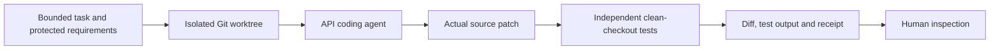

# Dispatcher — Engineering Showcase

**A coding task. An isolated change. Evidence you can inspect.**

Dispatcher is a proof of concept for delegating bounded coding tasks to agents,
isolating each attempt in Git, and independently checking the resulting change.

**This repository contains evidence and presentation material only. The application
implementation is private and is not distributed here.**

## Why build it?

A coding agent finishing its reply does not establish that a change stayed in
scope, passed protected checks, reached the intended revision or was safely
applied. Dispatcher explores that gap: explicit task contracts, isolated attempts,
independent verification and inspectable delivery evidence around interchangeable
coding agents. Its value as a portfolio project is the engineering of those
boundaries, rather than a claim of a finished autonomous software company.

Built as a personal engineering PoC: Python/FastAPI control service, Vue console,
Git worktrees, SQLite job/evidence state, Redis-backed compatibility services and
a provider gateway. The current delivery baseline is a persistent tenant
workstation; temporary per-job containers are a deferred design, not this demo.

## Technical reading path

| Read | What it explains |
| --- | --- |
| [Architecture](docs/architecture.md) | Control/workstation split, two execution paths, context, state and authority boundaries. |
| [Design decisions](docs/design-decisions.md) | Isolation, independent checks, conservative recovery and the tradeoffs made. |
| [Verification and evidence](docs/verification.md) | Exact sample inputs/results, negative controls, historical proof and what can be checked publicly. |
| [Limitations](docs/limitations.md) | Current gaps, trust assumptions, readiness and feature-freeze boundary. |

The README is the short tour; these documents form the longer engineering case study.

*24 seconds, six recorded views. The API implementation run was real. The console
views replay saved evidence; they are not a live screen recording or a live VM.*

## The experiment

A real `deepseek-v4-flash` API agent received a fixed discount-calculation task
with five protected acceptance requirements. It changed only `src/pricing.py`.
An independent verifier applied the actual patch to a clean Git checkout and
ran the acceptance tests again: **five passed**. The original sample repository
and protected tests were preserved. No change was published or applied to a user
project.

Two deterministic negative controls demonstrate refusal behavior:

| Candidate | Independently observed result |
| --- | --- |
| Real API-generated correction | Patch applied cleanly; all five acceptance tests passed; `verified_basic`. |
| Deliberately incorrect calculation | Real acceptance tests failed. |
| Protected tests changed to manufacture a pass | Scope validation refused the candidate before running its tests. |

The five requirements cover zero discount, an ordinary discount, full discount
and zero price, fractional-cent rounding, and invalid input refusal. The two
negative controls are fixed candidates, not claims about how the API model behaved.

## Inspect the actual evidence

- [API-generated sample patch](evidence/live-change.diff)
- [Independent acceptance test log](evidence/live-tests.log)
- [Agent's own response](evidence/agent-response.md)
- [Sanitized run and verification receipt](evidence/live-run.json)
- [Deterministic control results](evidence/controls.json)
- [Media and evidence hashes / provenance](evidence/manifest.json)

The patch and code fragments concern only a small synthetic pricing example;
they do not contain Dispatcher application code. Local home/executable paths
were redacted from the evidence export. The original private evidence digest is
retained. Sanitized receipts are presentation evidence, not runtime authorization.

## Existing interface, recorded results

The console uses illustrative project/account/source metadata to display saved
results. Its workstation stays offline and dispatch is disabled. The actual API
run happened before these views; it was not submitted through a production VM
or queue. The result remains review-required because tests, publication and
application are separate states.

Full-resolution views: [overview](screenshots/01-evidence-overview.jpg),
[complete evidence](screenshots/02-complete-evidence.jpg),
[conversation](screenshots/03-console-chat.jpg),
[source selector](screenshots/07-console-context.jpg),
[requirements](screenshots/09-console-requirements.jpg).
All screenshots are browser captures, not generated interface mockups.

## Engineering approach

The private implementation also contains native coding-agent adapters, signed
workstation delivery and durable project/job evidence. Separate historical trials
on October 2–9, 2026 exercised authenticated Codex/Antigravity sessions and Codex
task/file/result delivery between Linux control and tenant services. Those trials
are distinct from the API sample shown here. The former Linux environment was
removed; this repository does not recreate it or claim current installed readiness.

## What this repository is

An inspectable portfolio record of an implemented orchestration/verification PoC.
The application is not runnable from this repository: there are no application
modules, compiled frontend bundles, replay servers, agent-run scripts, credentials
or private Git history. Browsing the README, GIF and evidence makes no provider calls.

Self-service VM provisioning, embedded agent login, per-user key management,
complete installed CP1 acceptance and production SaaS readiness are not claimed.
Mechanical tests cover this sample, not semantic correctness of arbitrary code.

See [the Turkish presentation/share text](PRESENTATION_TR.md) for a ready-to-edit
announcement. The included animation is a GIF montage; no live screencast is included.
