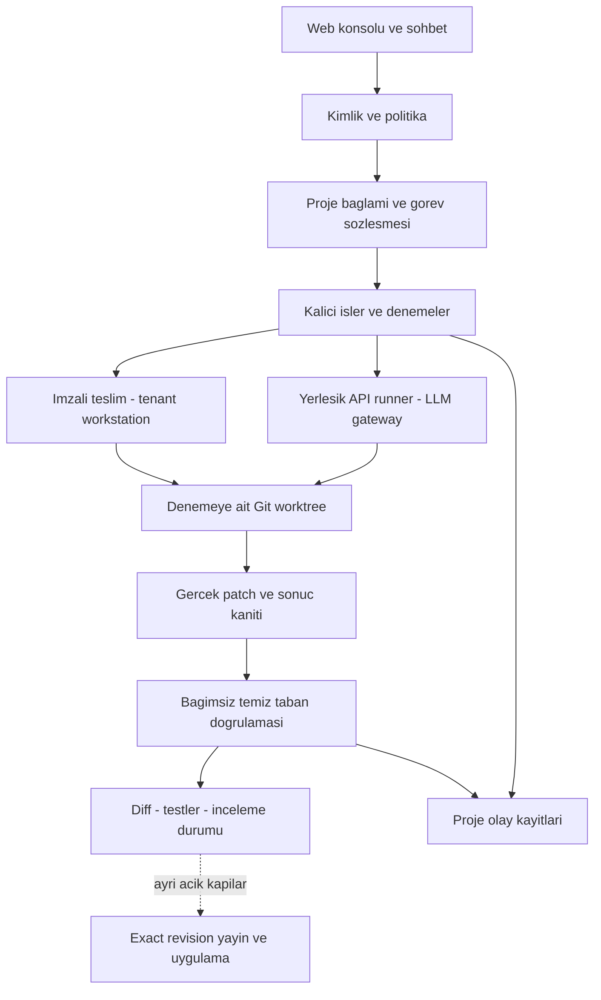
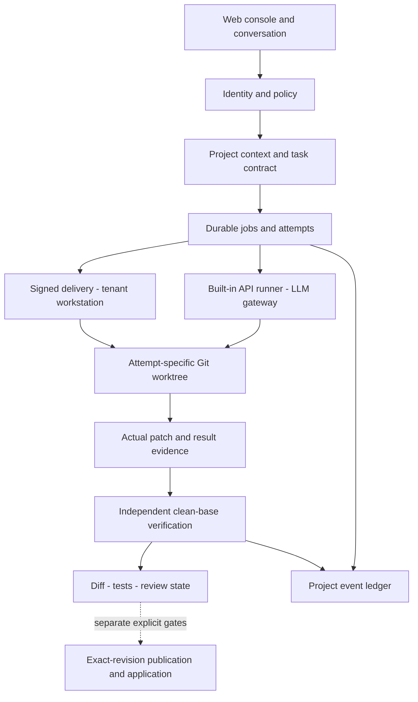

# Dispatcher

**Conversational coding-agent orchestration with isolated attempts and independent verification.**

[Türkçe](#turkce) · [English](#english) · [Ekranlar / Screenshots](#screenshots)


*24 saniye / 24 seconds · Gerçek API sonucu, kayıtlı konsol görüntüleri / Real API result, recorded console views.*

<a name="turkce"></a>

## Türkçe

**Durum: mühendislik PoC’si. Kaynak kodu private; bu repo teknik vaka incelemesi,
ekran görüntüleri ve temizlenmiş örnek kanıtlar içerir.**

[Proje](#tr-proje) · [Yetenekler](#tr-yetenekler) · [İş akışı](#tr-akis) ·
[Mimari](#tr-mimari) · [Kararlar](#tr-kararlar) · [Doğrulama](#tr-dogrulama) ·
[Mevcut durum](#tr-durum)

<a name="tr-proje"></a>

### Proje ve çözdüğü problem

Dispatcher, yazılım görevlerini sohbet üzerinden tanımlayıp kodlama ajanlarına
aktarırken görev bağlamını, yürütmeyi, doğrulamayı ve sonuç incelemesini yöneten
bir orkestrasyon prototipidir. Kullanıcı bir proje/kaynak seçer, ne yapılacağını
anlatır ve arka plandaki işin çıktısını diff, test sonucu ve görev kaydıyla inceler.

Bir ajanın “tamamladım” demesi; doğru dosyaların değiştiğini, korunan testlerin
geçtiğini veya değişikliğin doğru revizyona uygulandığını tek başına göstermez.
Dispatcher bu soruları ayrı sorumluluklar olarak ele alır: **işi tanımlamak →
izole yürütmek → bağımsız kontrol etmek → kanıtıyla incelemeye sunmak.**

Projenin mühendislik odağı; değiştirilebilir ajan adaptörleri, donmuş görev bağlamı,
Git izolasyonu, kalıcı iş/sahiplik kayıtları ve doğrulama sınırlarıdır. Aşağıdaki
indirim hesabı örneği bu yaklaşımın küçük bir gösterimidir; uygulamanın kapsamı
indirim hesaplamak değildir.

<a name="tr-yetenekler"></a>

### Uygulanan yetenekler

| Alan | Kullanıcıya ve sisteme sunduğu davranış |
| --- | --- |
| Proje odaklı sohbet | Seçilmiş projenin bağlamıyla konuşma, mevcut işi ve kayıtlı çıktıyı inceleme. |
| Kaynak ve bağlam | Okunabilir kaynak/snapshot seçimi, revizyon ve güncellik görünürlüğü; kabul edilen iş için sabit bağlam. |
| Görev sözleşmesi | Amaç, izinli kapsam, hariç tutulan yollar, hazırlık durumu ve risk seviyesiyle sınırlandırılmış iş. |
| Ajan/model yönlendirme | Planner, implementer, reviewer ve reconciler rolleri için kalite/kabiliyet politikası; seçilmiş native hedef/modeli onayla birlikte sabitleme. |
| API ve native adaptörler | Merkezi gateway üzerinden yerleşik API ajanı; Codex, Antigravity ve OpenCode için ayrı runner adaptörleri. Canlı kanıt her adaptör için aynı düzeyde değildir. |
| Arka plan işleri | Kabul edilen işler, ayrı denemeler, sahiplik lease’leri, iptal ve inceleme durumları; sonuçların proje sohbetine yansıması. |
| İzole çalışma alanı | Her denemeye donmuş Git tabanından ayrı worktree; doğrulama için ayrıca temiz checkout. |
| Bağımsız kontrol | Gerçek diff, kapsam, secret örüntüleri, patch uygulama ve test çıktısıyla derecelendirilmiş doğrulama kaydı. |
| İzlenebilirlik | Görev/deneme kimliği, base revision, patch hash’i, test günlüğü ve tenant/proje kapsamlı olay kayıtları. |
| Kalıcı workstation | Native oturum/proje verisi tenant ortamında kalır; kontrol düzlemi kapsamlı imzalı teslim ve sonuç kayıtlarıyla çalışır. |

Bu tablo uygulanan bileşenleri anlatır. Bileşenlerin varlığı, tamamının kurulu
ortamda tek bir uçtan uca kabul denemesini geçtiği anlamına gelmez; kanıt düzeyleri
[mevcut durum](#tr-durum) bölümünde ayrıdır.

<a name="tr-akis"></a>

### Kullanıcıdan sonuca çalışma akışı

1. **Proje ve kaynak:** Kullanıcı proje bağlamını seçer; revizyon ve gözlem zamanı görünür.
2. **Sohbet ve netleştirme:** İstek danışma, durum inceleme veya yürütülebilir görev olarak ele alınır; eksik bilgi gerektiğinde netleştirilir.
3. **Görev ve onay:** Kapsam, risk ve gerekli onay değerlendirilir. Kabul edilen iş kendi bağlam/revizyonunu saklar.
4. **Hedef seçimi:** Uygun runner/model politikadan geçer; açık native seçim onaylanan hedefe bağlı kalır.
5. **Ayrı deneme:** Ajan kendi Git worktree’sinde çalışır; özgün proje checkout’u aday değişiklikten ayrılır.
6. **Bağımsız doğrulama:** Ajanın açıklaması yerine gerçek patch ve kontrol çıktıları değerlendirilir.
7. **İnceleme:** Sohbet ve iş detayında çıktı, diff, test sonucu ve durum gösterilir.
8. **Ayrı uygulama kapısı:** Doğrulanan adayın yayınlanması/projeye uygulanması ayrı revizyon ve yetki kontrollerine tabidir.

Teslim alınan çıktı, doğrulanmış kod ve projeye uygulanmış değişiklik ayrı
durumlardır. Başarıyla teslim edilen bir rapor `unverified` kalabilir. Üründeki
Git yayın adımı da otomatik GitHub push veya deployment anlamına gelmez.

<a name="tr-mimari"></a>

### Sistem mimarisi



Şema bileşen sorumluluklarını gösterir. Kontrol düzlemi kimliği, onayı, kuyruğu ve
kanıtı yönetir; native kullanıcı oturumları tenant workstation’da kalır. Native
çıktılar imzalı sonuç/artefakt kanalıyla döner. API ajanı merkezi provider gateway’i
kullanır. Public örnek, bu API yolunun kuyruk/tenant tesliminden ayrı, doğrudan
çalıştırılmış sınırlı bir denemesidir.

| Katman | Teknoloji / yaklaşım | Sorumluluk |
| --- | --- | --- |
| Backend | Python 3.12+, FastAPI, Pydantic | API, sözleşmeler, politika ve orkestrasyon. |
| Arayüz | Vue, Vite | Proje sohbeti, kaynak seçimi, iş ve kanıt inceleme. |
| Kalıcı durum | SQLite/WAL, kalan dosya tabanlı kayıtlar | İş/deneme, teslim, proje olayları ve journal. |
| Uyumluluk/cache | Redis | Oturum, cache ve idempotency uyumluluk yolları. |
| İzolasyon | Git worktree, donmuş base revision | Denemeyi özgün checkout’tan ayırma ve temiz tabana yeniden uygulama. |
| Model erişimi | Merkezi gateway; Gemini, OpenAI, Anthropic, OpenAI-compatible adaptörleri | Vendor ayrıntılarını uygulama/politika kodundan ayırma. |
| Native yürütme | Runner adaptörleri ve kalıcı tenant workstation | Yerel login/proje durumu, seçilmiş CLI ve sahipli yürütme. |
| Doğrulama | Diff/scope/secret kontrolü, temiz checkout; workstation yolunda ayrı mirror ve isteğe bağlı container test profili | Aday değişikliği uygulayıcıdan bağımsız değerlendirme. |

Mevcut teslim tabanı **kalıcı workstation + deneme başına worktree** düzenidir.
Her işte geçici container ve oturum taşıma tasarım olarak ertelenmiştir. Bu taban
Docker-in-Docker gerektirmez; otomatik VM oluşturma veya sıfır boşta maliyet sunmaz.

<a name="tr-kararlar"></a>

### Önemli mühendislik kararları

| Karar | Neden | Bedeli / sınırı |
| --- | --- | --- |
| Küçük, donmuş görev sözleşmesi | Son sohbet mesajının kapsamı sessizce değiştirmesini önlemek. | Daha açık durum yönetimi; gereksinimlerin eksiksizliğini tek başına kanıtlamaz. |
| Deneme ve doğrulamaya ayrı checkout | Adayı özgün projeden, kontrolü ajan çalışma alanından ayırmak. | Ek disk/checkout ve yaşam döngüsü yönetimi. |
| Uygulayıcıdan bağımsız kontrol | “Testler geçti” açıklaması yerine gerçek diff ve test kanıtını değerlendirmek. | Ek test süresi; mekanik kontroller semantik doğruluğun tamamını kanıtlamaz. |
| Tek gateway ve değiştirilebilir runner | Vendor/CLI ayrıntılarını politika ve kalıcı durum koduna yaymamak. | Her adaptörün auth, araç ve hata davranışı ayrı doğrulama ister. |
| Kalıcı workstation | Login ve proje devamlılığını, kanıtlanmamış oturum taşımasına bağlamamak. | Bakım ve boşta kaynak maliyeti; worktree tenant güvenlik izolasyonu değildir. |
| Kalıcı journal ve idempotent kanıt teslimi | Yanıt kaybında ücretli ajanı yeniden çalıştırmadan aynı kanıtı göndermek. | Daha çok geçiş; belirsiz sahiplikte otomatik devam yerine inceleme. |
| Exact revision için ayrı uygulama kapısı | Doğru adayın hareket etmiş yanlış tabana uygulanmasını önlemek. | Doğrulama, yayın ve uygulama ayrı durumlar olarak görünür. |

ContextRail biçimindeki proje hafızası; mevcut sistem haritası, aktif işler, kararlar
ve tamamlanma kanıtını ayırır. Bağlam importu gözlem ve revizyon taşır; bir dokümanın
“aktif görev” demesi yürütme onayı sağlamaz. Kabul edilmiş işin bağlamı sonraki
doküman değişikliğiyle sessizce yenilenmez.

SQL sahiplik kayıtları ve tenant journal’ları kesintiden sonra kanıtı korur.
Toparlanma, eşleşen kayıtlarla eksik sohbet projeksiyonlarını onarabilir; belirsiz
eski işi yeniden başlatmaz veya başarılı ilan etmez. Yerel süreç temizliği uzak
ajanın/provider tarafının durduğunu kanıtlamaz; bilinmeyen stop durumu görünür kalır.

<a name="tr-dogrulama"></a>

### Somut doğrulama: gerçek API ajanı

22 Ekim 2026’da `deepseek-v4-flash`, beş korunan kabul koşulu verilen küçük bir
örnekte `src/pricing.py` dosyasını düzeltti. Yerleşik ajan en fazla altı tur ve
180 saniye deadline ile çalıştı. Bağımsız doğrulayıcı gerçek patch’i donmuş tabanın
temiz checkout’una uygulayıp testleri tekrar çalıştırdı: **beş kabul testi geçti,
sonuç `verified_basic`**. Özgün örnek kaynak, testler ve HEAD korundu.

| Kontrol | Beklenen ve gözlenen sonuç |
| --- | --- |
| REQ-001 | Sıfır indirim fiyatı korur. |
| REQ-002 | 1000 kuruşa %20 indirim sonucu 800 kuruştur. |
| REQ-003 | %100 indirim sıfır verir; sıfır fiyat sıfır kalır. |
| REQ-004 | Kesirli kuruş aşağı yuvarlanır: 199’a %10 indirim → 179. |
| REQ-005 | Negatif fiyat veya %0–100 dışındaki oran `ValueError` ile reddedilir. |

| Aday | Bağımsız gözlem |
| --- | --- |
| Gerçek API düzeltmesi | Yalnız izinli kaynak değişti; patch temiz tabana uygulandı; 5 test geçti. |
| Deterministik doğru kontrol | Gerçek Git/test yolu başarılı adayı kabul etti. |
| Deterministik hatalı hesap | Gerçek kabul testleri başarısız oldu. |
| Deterministik test dosyası değişikliği | Kapsam kontrolü adayı, aday testlerini çalıştırmadan reddetti. |

Son üç satır sabit kontrol adaylarıdır; canlı modelin bu davranışları yaptığı
iddia edilmez. Bu deneyde tenant kuyruğu, VM, native CLI veya semantic reviewer
kullanılmadı; kod kullanıcı projesine uygulanmadı/yayınlanmadı. Makbuzdaki
`merge_eligible` alanı gerçek bir merge veya deployment yapıldığı anlamına gelmez.
Ham kayıtlar [teknik kanıt ekinde](#evidence) bulunur.

<a name="tr-durum"></a>

### Mevcut durum ve sınırlar

| Kanıt düzeyi | Gösterilen / kalan sınır |
| --- | --- |
| Public API örneği | Gerçek model düzeltmesi, temiz checkout, beş test ve ayrı ret kontrolleri. Küçük bir örnektir. |
| Private geliştirme regresyonu | Kayıtlı tam backend snapshot’ı: 1540 passed, 22 skipped, 5 live deselected. Suite ve kaynak burada dağıtılmıyor; bu bakımcı beyanıdır. |
| Tarihli native denemeler | 2–9 Ekim’de Linux ortamında authenticated Codex/Antigravity ve görev/dosya/sonuç hattı denendi. Başarılı Codex raporu ayrıca completed/unverified kabul edildi. |
| Kurulu CP1 kabulü | Native yürütmeden bağımsız doğrulama ve exact yayın/uygulamaya uzanan birleşik kurulu ortam kabulü tamamlanmadı. |
| Operasyonel SaaS | Self-service kayıt/VM, production SSO/billing, çok düğümlü işletim ve otomatik ortam yaşam döngüsü iddiası yok. |

Önceki WSL/Docker ortamı 14 Ekim’de kaldırıldı. Native denemeler tarihli geçmiş
kanıttır; ekranlar mevcut bir VM’nin canlı çalışması değildir. Public test günlüğü
örnek göreve aittir; backend suite’i ve eski native journal’ları içermez.

**Güven sınırı:** Git worktree sürüm kontrolü izolasyonudur, OS sandbox’ı değildir.
Yerleşik API runner’ın komut aracı operatör ortamında çalışır; prompt’taki ağ/env
kısıtları güvenlik sandbox’ı sağlamaz. Public örnek güvenilen, sabit görevle sınırlıdır.
Workstation doğrulamasındaki operator mirror/container kontrolleri ayrı sınırdır.

Kalan dosya tabanlı durum ve süreç içi koordinasyon, tam çok süreçli/çok düğümlü
production kalıcılığı iddiasını engeller. Kaynak private olduğu için okuyucu
uygulamanın tamamını bu repodan kuramaz veya bağımsız denetleyemez. Testler belirli
davranışları; hash’ler dosya tutarlılığını gösterir, genel doğruluk/kimlik garantisi vermez.

Proje portföy PoC’si olarak dondurulmuştur. Yeni ürün geliştirme, somut kullanıcı
ihtiyacı veya sınırları belirlenmiş bir pilot gerektirdiğinde yeniden değerlendirilecektir.

---

<a name="english"></a>

## English

**Status: engineering proof of concept. Application source is private; this
repository contains the technical case study, screenshots and sanitized sample evidence.**

[Overview](#en-project) · [Capabilities](#en-capabilities) · [Workflow](#en-workflow) ·
[Architecture](#en-architecture) · [Decisions](#en-decisions) ·
[Verification](#en-verification) · [Current status](#en-status)

<a name="en-project"></a>

### Project and problem

Dispatcher is a conversational orchestration prototype that manages task context,
execution, verification and result inspection around coding agents. A user selects
a project/source, describes the work and inspects background output through its
diff, test results and job record.

An agent saying “done” does not establish which files changed, whether protected
tests passed or whether the intended revision was applied. Dispatcher treats these
as distinct responsibilities: **define the task → execute in isolation → check
independently → present inspectable evidence.**

The engineering focus is replaceable runner adapters, frozen task context, Git
isolation, durable job/ownership records and verification boundaries. The pricing
example below demonstrates this approach; discount calculation is not the scope
of the application.

<a name="en-capabilities"></a>

### Implemented capabilities

| Area | User/system behavior |
| --- | --- |
| Project conversation | Consult selected project context and inspect current jobs and saved output. |
| Sources and context | Readable source/snapshot selection, revision/freshness visibility and frozen accepted-job context. |
| Task contract | Bound work by goal, allowed scope, excluded paths, readiness and risk tier. |
| Agent/model routing | Quality/capability policies for planner, implementer, reviewer and reconciler; freeze explicit native target/model approval. |
| API and native adapters | Built-in API agent behind a central gateway; separate Codex, Antigravity and OpenCode runner adapters. Live evidence differs by adapter. |
| Background work | Accepted jobs, separate attempts, ownership leases, cancellation/review states and project-chat result projection. |
| Isolated workspaces | Attempt-specific worktrees at a frozen Git base and another clean checkout for verification. |
| Independent checking | Graded evidence from actual diff, scope, secret-pattern checks, patch application and test output. |
| Traceability | Job/attempt identity, base revision, patch hash, test logs and tenant/project-scoped events. |
| Persistent workstation | Native login/project data stays in the tenant environment; control uses scoped signed delivery/result records. |

These are implemented component capabilities. They do not establish that every
component has passed one combined installed end-to-end acceptance run. Evidence
levels are separated in [current status](#en-status).

<a name="en-workflow"></a>

### From user request to inspected result

1. **Project/source:** Select project context with visible revision and observation time.
2. **Conversation/clarification:** Treat the request as consultation, status inspection or executable work; clarify missing information when needed.
3. **Contract/approval:** Evaluate scope, risk and required approval; persist the accepted job’s context/revision.
4. **Target selection:** Apply runner/model policy and preserve the exact explicitly approved native target.
5. **Separate attempt:** Run the agent in its own Git worktree, apart from the original checkout.
6. **Independent verification:** Evaluate the actual patch and check output rather than implementer prose.
7. **Inspection:** Return output, diff, test results and state to conversation/job details.
8. **Separate application gate:** Publish/apply a verified candidate only through its revision and authority checks.

Received output, verified code and an applied change are distinct states. An
explicitly accepted report can complete delivery while remaining `unverified`.
Product Git publication does not implicitly mean GitHub push or deployment.

<a name="en-architecture"></a>

### System architecture



The diagram shows component responsibilities. Control owns identity, approval,
queueing and evidence; native login state stays on the tenant workstation. Native
results return through signed result/artifact channels. The API runner uses the
central provider gateway. The public example is a bounded direct API run outside
the queue/tenant delivery path.

| Layer | Technology / approach | Responsibility |
| --- | --- | --- |
| Backend | Python 3.12+, FastAPI, Pydantic | APIs, contracts, policy and orchestration. |
| Frontend | Vue, Vite | Project conversation, source selection, job/evidence inspection. |
| Durable state | SQLite/WAL with remaining file-backed records | Jobs/attempts, delivery, project events and journals. |
| Compatibility/cache | Redis | Session, cache and idempotency compatibility paths. |
| Isolation | Git worktrees and frozen base revisions | Separate attempts from the original checkout and reapply to a clean base. |
| Model access | Central gateway; Gemini, OpenAI, Anthropic and OpenAI-compatible adapters | Contain vendor details outside application/policy code. |
| Native execution | Runner adapters and persistent tenant workstation | Local login/project state, selected CLI and owned execution. |
| Verification | Diff/scope/secret checks, clean checkouts; separate workstation mirrors and optional container test profiles | Evaluate candidates independently of the implementer. |

The delivery baseline is **persistent workstation + worktree per attempt**.
Disposable per-job containers and portable login state are deferred. This baseline
does not require Docker-in-Docker or promise automatic VM creation/zero idle cost.

<a name="en-decisions"></a>

### Engineering decisions

| Decision | Reason | Cost / boundary |
| --- | --- | --- |
| Small frozen task contract | Prevent later conversation from silently changing accepted scope. | More explicit state; contract validity alone cannot prove requirements completeness. |
| Separate attempt/verification checkouts | Separate candidates from the original project and checking from the agent workspace. | More storage, checkout and lifecycle work. |
| Independent verification | Evaluate actual diffs/tests instead of “tests passed” prose. | Additional test time; mechanical checks cannot prove all semantics. |
| One gateway and replaceable runners | Keep vendor/CLI details out of policy and persistence. | Each connector needs its own auth/tool/error evidence. |
| Persistent workstation | Preserve login/project continuity without depending on unproven session portability. | Maintenance/idle cost; worktrees are not tenant security isolation. |
| Durable journal/idempotent evidence delivery | Resend frozen evidence after response loss without rerunning a paid agent. | More transitions; uncertain ownership stops for review. |
| Separate exact-revision application gate | Prevent applying the right candidate to a changed/wrong target base. | Verification, publication and application remain visible separate states. |

ContextRail-style memory separates the current system map, active work, rationale
and completion evidence. Context import carries observations/revisions; an “active”
document does not authorize execution. Later document edits must not silently
replace an accepted job’s context.

SQL ownership records and tenant journals retain evidence across interruptions.
Recovery can repair missing chat projections from matching saved records; it does
not redispatch uncertain old work or declare it successful. Local process teardown
cannot prove remote/provider-side stop, so unknown stop status remains explicit.

<a name="en-verification"></a>

### Concrete verification: a real API agent

On October 22, 2026, `deepseek-v4-flash` repaired `src/pricing.py` in a small sample
with five protected acceptance requirements. The built-in agent had at most six
rounds and a 180-second deadline. An independent verifier reapplied the actual
patch to a clean checkout at the frozen base and reran the tests: **five passed,
grade `verified_basic`**. Original sample source, tests and HEAD were preserved.

| Check | Expected and observed behavior |
| --- | --- |
| REQ-001 | Zero discount preserves the price. |
| REQ-002 | A 20% discount on 1000 cents yields 800. |
| REQ-003 | Full discount yields zero; zero price stays zero. |
| REQ-004 | Fractional cents round down: 199 with 10% discount → 179. |
| REQ-005 | Negative price or percentage outside 0–100 raises `ValueError`. |

| Candidate | Independent observation |
| --- | --- |
| Real API correction | Only allowed source changed; patch applied cleanly; all 5 tests passed. |
| Deterministic correct control | The real Git/test path accepted a valid candidate. |
| Deterministic incorrect calculation | Actual acceptance tests failed. |
| Deterministic test-file change | Scope validation refused it before running candidate tests. |

The last three rows are fixed control candidates, not claims about live-model
behavior. This experiment used no tenant queue, VM, native CLI or semantic reviewer;
it did not publish/apply code to a user project. The receipt’s `merge_eligible`
field is not evidence of an actual merge or deployment. Raw artifacts are in the
[technical evidence appendix](#evidence).

<a name="en-status"></a>

### Current status and boundaries

| Evidence level | Demonstrated / remaining boundary |
| --- | --- |
| Public API sample | Real model correction, clean checkout, five tests and separate refusal controls. One small sample. |
| Private source regression | Recorded full backend snapshot: 1540 passed, 22 skipped, 5 live deselected. Source/suite are not distributed here; this is a maintainer-reported result. |
| Historical native trials | October 2–9 Linux trials exercised authenticated Codex/Antigravity and task/file/result transport. A successful Codex report was separately accepted completed/unverified. |
| Installed CP1 acceptance | Combined installed native execution, independent verification and exact publication/application remains incomplete. |
| Operational SaaS | No self-service signup/VM, production SSO/billing, multi-node operation or automatic environment lifecycle claim. |

The previous WSL/Docker environment was removed on October 14. Native trials are
dated historical evidence; the screenshots do not show a currently running VM.
The public test log covers the sample task, not the backend suite or old native journals.

**Trust boundary:** A Git worktree is version-control isolation, not an OS sandbox.
The built-in API runner’s command tool runs in the operator environment; prompt
network/env restrictions do not provide sandbox enforcement. The public example
uses a fixed trusted task. Operator mirrors/container checks in workstation
verification form a separate boundary.

Remaining file-backed state and process-local coordination prevent a claim of
complete multi-process/multi-node production persistence. Readers cannot install
or independently audit the entire private application from this repository. Tests
establish specific behavior; hashes establish artifact consistency, not general
correctness or independently authenticated provenance.

The project is frozen as a portfolio PoC. Further product work will be reconsidered
when concrete user demand or a bounded pilot justifies it.

---

<a name="screenshots"></a>

## Ekranlar / Screenshots

Görseller mevcut Vue konsolunun kayıtlı sonuçlarını gösterir. Proje/hesap/kaynak
metadatası temsili, workstation çevrimdışı ve dispatch kapalıdır. Gerçek API
çalışmasının diff/test çıktısı kullanılır. GIF altı kayıtlı ekranın montajıdır;
canlı ekran kaydı veya AI ile üretilmiş arayüz değildir.

These are browser captures of saved results in the existing Vue console. Account,
project and source metadata is illustrative; the workstation is offline and
dispatch disabled. Diff/test data comes from the real API run. The GIF combines
six recorded views; it is not a live screencast or an AI-generated interface.

**Sohbet ve sonuç / Conversation and result**


**İşler ve inceleme durumu / Jobs and review state**


**Gerçek diff / Actual diff**


**Bağımsız test sonucu / Independent test result**


**Kapsam ihlalinin reddi / Scope refusal**


<details>
<summary>Diğer ekranlar / Additional views</summary>

- [Kaynak ve bağlam seçimi / Source and context selection](screenshots/07-console-context.jpg)
- [Gereksinimler ve kapsam / Requirements and scope](screenshots/09-console-requirements.jpg)
- [Kanıt özeti / Evidence overview](screenshots/01-evidence-overview.jpg)
- [Tam kanıt sayfası / Full evidence page](screenshots/02-complete-evidence.jpg)

</details>

<a name="evidence"></a>

## Teknik kanıt eki / Technical evidence appendix

<details>
<summary>Gerçek örnek dosyalarını ve provenance bilgisini aç / Expand sample artifacts and provenance</summary>

| Dosya / File | Amaç / Purpose |
| --- | --- |
| [live-change.diff](evidence/live-change.diff) | Gerçek API patch’i / Actual API-generated patch. |
| [live-tests.log](evidence/live-tests.log) | Bağımsız kabul testleri / Independent acceptance-test output. |
| [live-run.json](evidence/live-run.json) | Görev girdisi, revizyon, zaman ve doğrulama makbuzu / Task input, revision, timestamps and receipt. |
| [controls.json](evidence/controls.json) | Deterministik doğru/hatalı/kapsam dışı kontroller / Deterministic valid, broken and out-of-scope controls. |
| [agent-response.md](evidence/agent-response.md) | Doğrulayıcıdan ayrı ajan açıklaması / Agent explanation, separate from the verifier. |
| [manifest.json](evidence/manifest.json) | Kanıt, JPEG ve GIF SHA-256 değerleri / Evidence, JPEG and GIF SHA-256 hashes. |

Yalnız küçük sentetik örneğin kod parçaları paylaşılır. Yerel home/executable
yolları temizlenmiştir; özgün private kanıtın digest’i kayıtta tutulur. Temizlenmiş
makbuzlar sunum kanıtıdır, runtime yetkisi vermez. Hash karşılaştırmaları patch/log
satır sonları dahil özgün byte’larla yapılır; Git attributes bu byte’ları korur.
Manifest kendisini hash’lemez. Dosyayı yeniden kaydetmek hash’i değiştirebilir.

Only code fragments from the small synthetic example are shared. Local home/
executable paths were redacted and the original private evidence digest retained.
Sanitized receipts are presentation evidence, not runtime authorization. Compare
original bytes, including patch/log line endings; Git attributes preserve them.
The manifest does not hash itself. Resaving a file may change its hash.

Patch SHA-256:

```text
7fe04967b2c6cd00af6e4d5ff80dcfa51ecbdbbf1493a6be581e0bd23b6ed506
```

</details>

---

**Geliştiren / Author:** Muhammet Işık · **Tür / Type:** source-private engineering PoC.
