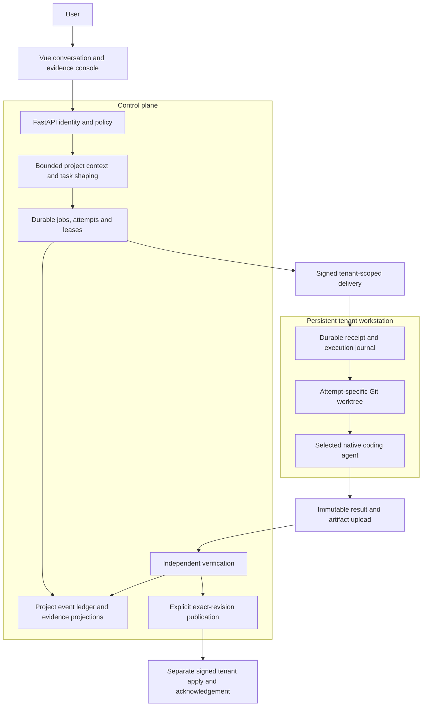
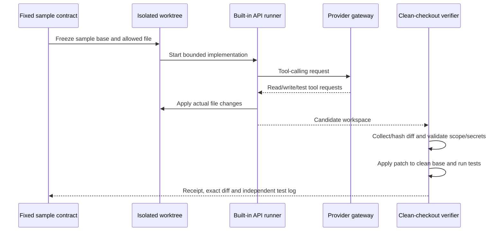

# Dispatcher architecture

This document describes the implemented PoC at the October 22, 2026 showcase
snapshot. The recorded API example, the broader workstation design and its
remaining installed acceptance gates are deliberately identified below. The
application source is private; this is an explanatory case study.

## The problem and the system boundary

An implementation agent can modify a repository and announce success. An
orchestrator still has to establish whose task it is, which input revision was
used, what changed, which checks actually ran, whether execution is still owned,
and which revision may be applied. Those are separate responsibilities.

Dispatcher puts the coding agent behind a task/execution contract. It owns the
surrounding conversation, task state, workspace isolation, verification evidence
and explicit delivery/application transitions. It does not replace Git, coding
agent authentication, a model provider or an operating-system security sandbox.

This is the workstation path. Its components have local behavior tests and dated
native transport trials; the entire verification/publication/application chain
has not passed installed CP1 acceptance. The real API example below uses a smaller
direct path, outside this queue and tenant channel.

## Responsibilities and technology

| Component | Owns | Must not infer |
| --- | --- | --- |
| Vue console | Source selection, conversation, pending approvals, diff/test inspection | A visible result is not permission to execute or publish. |
| FastAPI control service | Authenticated tenant/project APIs, policy, task acceptance | Caller-supplied tenant/repo information is not authority by itself. |
| Context/shaper | Bounded project observations, task goal, scope and exclusions | A document saying a task is active is not execution approval. |
| Queue | Accepted jobs, attempts, SQL-fenced leases and conservative recovery | A timed-out lease does not establish that remote work stopped. |
| Runner adapters | Native CLI or gateway-backed implementation, normalized output | An agent's success message is not independent verification. |
| Tenant workstation | Local login/session state, repository binding, attempt worktrees | Heartbeat readiness does not enable execution. |
| Verification plane | Independent diff/scope/secret/test checks and graded evidence | Passing tests do not prove arbitrary semantic correctness. |
| Delivery/application | Exact candidate, frozen-base checks and acknowledgements | A stored result does not imply merge, deployment or GitHub push. |
| Project ledger | Tenant/project events, ordering and replayable projections | A chat projection does not replace the authoritative job record. |

SQLite/WAL stores the project event ledger and control-plane job/delivery records.
Redis supports sessions/cache/idempotency compatibility paths. Some lifecycle and
projection state remains file-backed. This is not a fully migrated multi-node
database architecture. See [remaining limits](limitations.md).

## From conversation to a bounded task

The minimal task describes `goal`, allowed `scope`, `excluded` paths,
`implementation_ready` and `risk_tier`. Richer slices can add acceptance checks,
preconditions and session strategy. A frozen dispatch context binds the project,
tenant, base revision and memory snapshot used for that attempt.

Project context can include a bounded view of repository documents, status and
recent history. ContextRail separates the current system map, active queue,
rationale and completion evidence. Import is observation with hashes/revisions;
it is not adoption of arbitrary instructions as approval. Later document changes
must not silently rewrite an already accepted task's scope.

The implemented role policy distinguishes planner, implementer, reviewer and
reconciler. Risk and ambiguity determine a minimum model quality tier; preference,
availability and cost rank eligible targets. This is an execution policy, not a
claim that this one showcase run exercised every role or provider failover.

## Two execution paths

### Direct API path: used in this showcase

The built-in runner uses the central provider gateway rather than importing vendor
SDKs into orchestration code. Available file/command tools support implementation
inside a workspace. The showcased run used an OpenAI-compatible provider and
`deepseek-v4-flash`, with a six-round limit and a 180-second agent deadline.

Only a fresh synthetic sample was used. The main application repository and the
sample's original source/acceptance tests were preserved. No tenant job, production
queue, VM, native CLI session or publication was involved in this run.

A Git worktree isolates changes; it does **not** confine arbitrary processes.
The API runner's command tool runs in the operator environment. Prompt instructions
against network/environment access are not an OS sandbox guarantee. This direct
path is suitable here for the trusted, fixed demonstration, not untrusted hosted
customer code. Independent verification checks the resulting candidate; it does
not undo side effects an arbitrary command could have caused.

### Persistent workstation path: broader implemented system

The control service and tenant runtime have separate identities and data roots.
Native login/session files live with the tenant environment. The control plane
uses scoped signed messages and normalized evidence rather than copying native
credential stores into job payloads.

The tenant journal separates receiving an offer, preparing a frozen worktree,
executing the selected CLI, and uploading immutable result/artifact bytes. Each
transition has its own ownership and replay checks. Receipt acknowledgement alone
does not start execution. Control and tenant execution options are explicitly
enabled separately; the default tenant loop is heartbeat-only.

A result is bound to tenant, project, job, attempt and delivery ownership. Response
loss can trigger re-upload of the same saved bytes; it must not rerun the native
agent. Restarted uncertain execution requires review. Current browser/API source
selection freezes the intended native target/model; fresh checks must not silently
substitute a different model for that approval.

The current baseline keeps one persistent workstation and creates a separate Git
worktree for each attempt. Per-job disposable containers and portable user login
state remain deferred. No Docker-in-Docker arrangement is required by this baseline.

## Verification and application are distinct

The direct sample verifier collects the actual diff, hashes its bytes, checks
scope and secrets, applies it to a clean checkout at the frozen base, and executes
the protected acceptance tests. Its receipt records outcomes and the patch/base
identity. The sample obtained `verified_basic`; no independent semantic reviewer
was run. Its `merge_eligible` receipt field was not an actual merge/publication.

The workstation verifier has a different trust boundary: uploaded artifacts are
reconstructed against operator-owned Git mirrors. Optional tests use a pinned
operator profile in a constrained container rather than a tenant-supplied shell
command on the control host. Optional BASIC promotion, control Git publication
and signed tenant apply each have separate gates. Local tests of these components
do not establish their combined installed readiness.

An explicitly accepted report can complete delivery while remaining `unverified`.
A code change requires the relevant independent evidence and application gates.
Neither path implicitly performs a GitHub push or deployment.

## Recovery, cancellation and visibility

Durable SQL attempts and tenant journals retain evidence when a response is lost.
Recovery repairs missing chat projections only when the saved receipt/result
identity matches. It does not redispatch work or promote an uncertain result.

Process cancellation must retain ownership through spawn, stop and reader teardown.
An unconfirmed local process-tree stop stays explicit; local completion is not
proof that provider-side or remote execution stopped. Heartbeats describe current
observed state and execution settings, not ownership renewal or approval.

The console shows the source, attempt state and evidence for inspection. In this
public package those are **recorded views** using illustrative account/project
metadata and real saved diff/test results. Browsing them starts no process.

## What this architecture demonstrates

The case study demonstrates how one implementation separates intent, execution,
verification, delivery and application instead of collapsing them into an agent
reply. The public artifacts support a concrete small API example and refusal
controls. The stronger native/installed and production claims remain outside the
evidence boundary. Continue with [design decisions](design-decisions.md),
[verification](verification.md) and [limitations](limitations.md).
